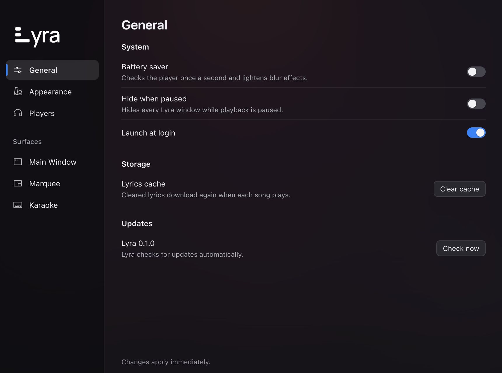
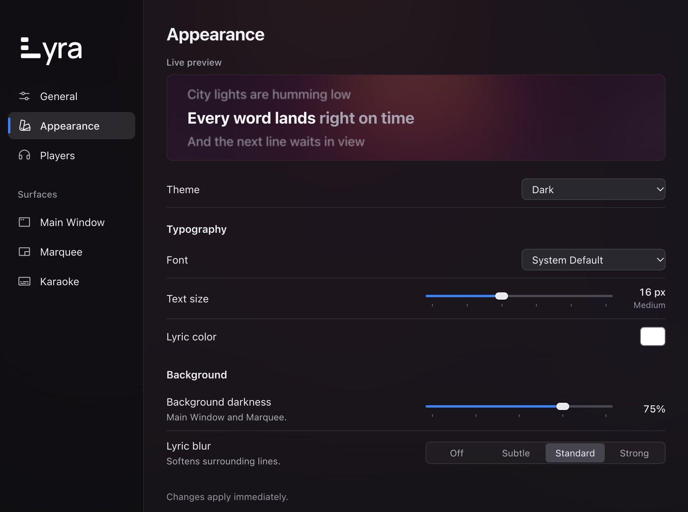
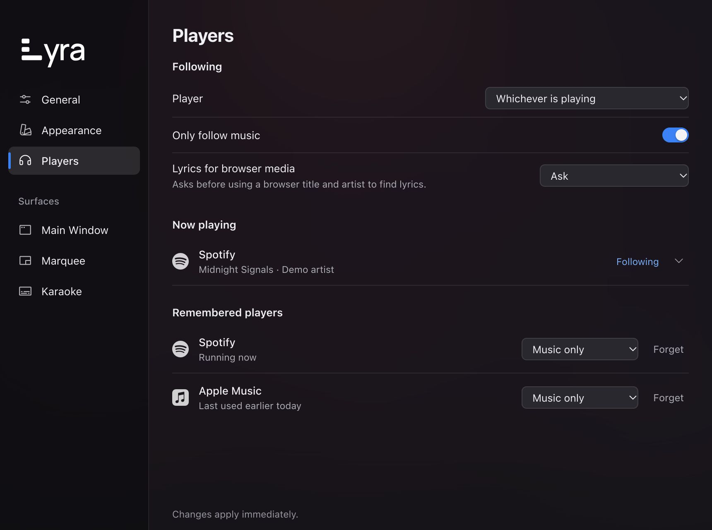
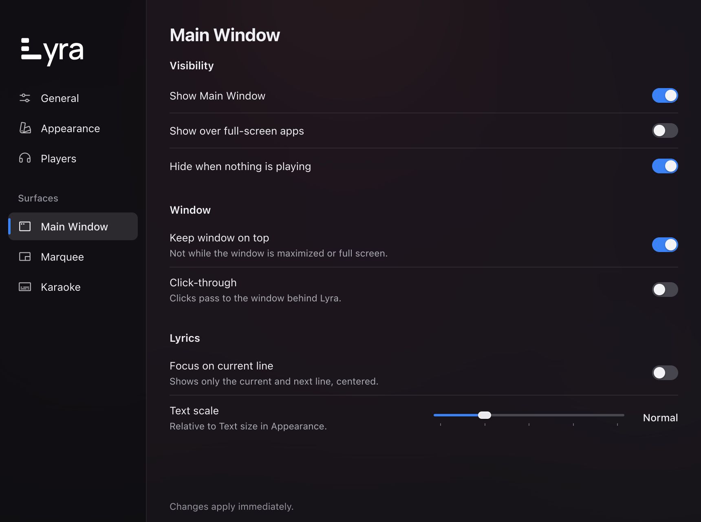
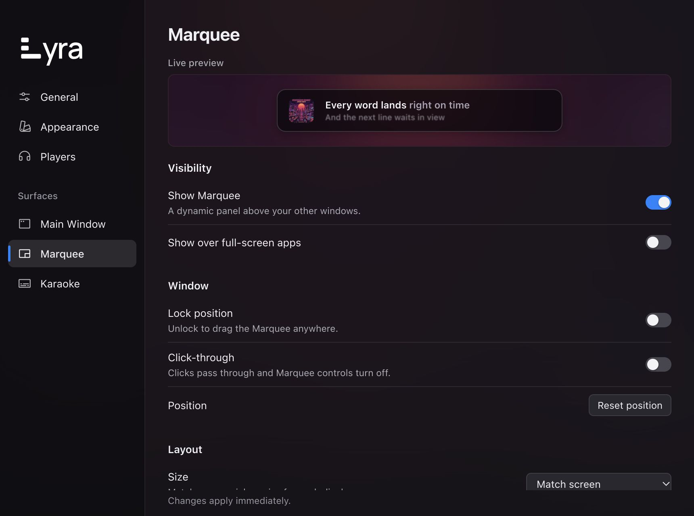
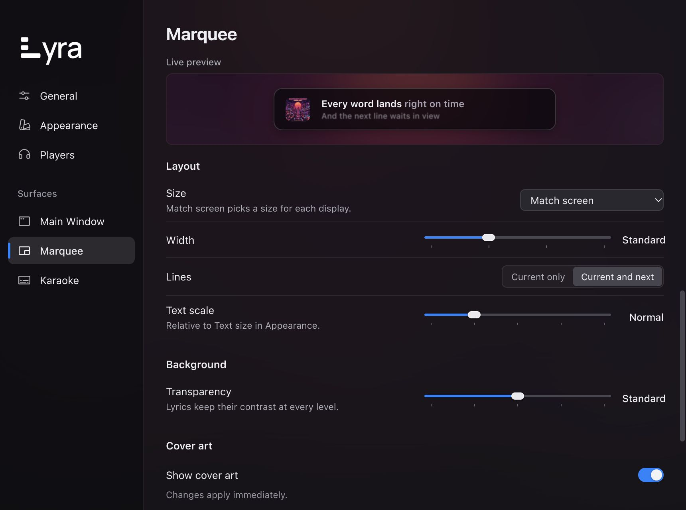
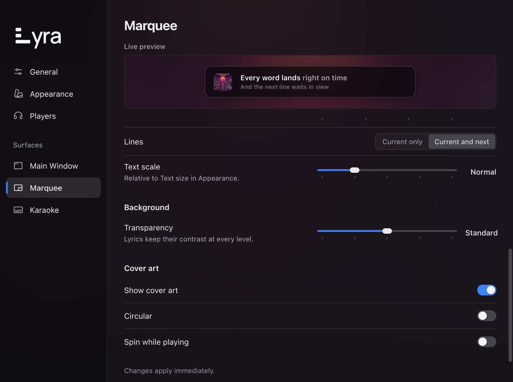
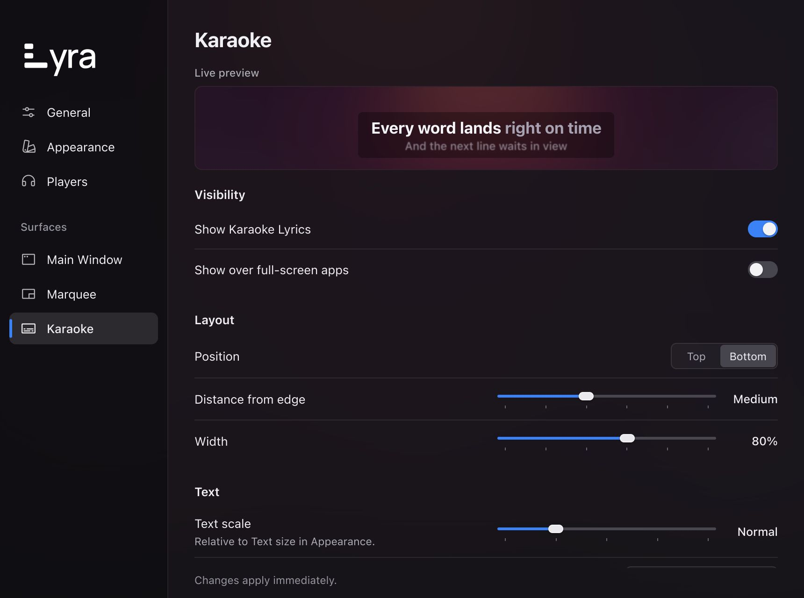
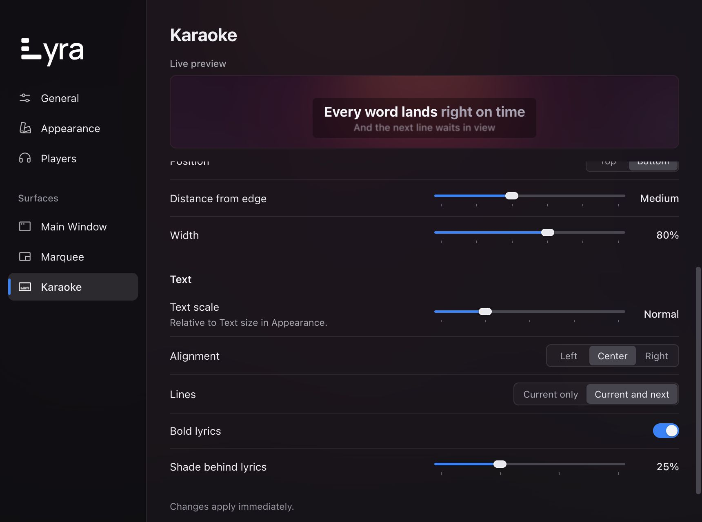
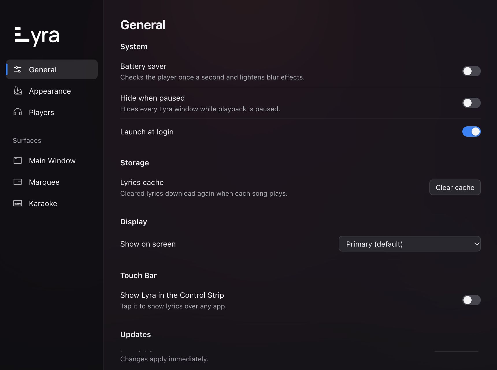

# Lyra Settings Mockups

Final reference package · 13 October 2026

These mockups use the approved design direction with the final corrections: title-only page headers, the app's actual system font, exact softer outline icons, a Theme select, refined capsule sliders, and the real white integrated wordmark. Every capture represents 860 x 640 logical pixels at 2x. They show application content; native operating-system chrome is supplied by Tauri in the real app.

The example values are illustrative. The other settings sections apply the selected Appearance direction to the existing inventory. Refer to [the design specification](DESIGN.md) for behavior, state mappings, and implementation requirements.

## General

System behavior, storage, and updater state. Hardware-specific rows are omitted in the normal scenario.

## Appearance

The final primary design. There is no subtitle below the page title. Theme and Font use aligned selects; the normal content fits without scrolling.

## Players

Following policy, current sessions, and remembered apps remain distinct. Player names and track data are examples, not live verification.

## Main Window

Visibility, window behavior, and lyric scale retain the existing control set.

## Marquee upper view

The dynamic-panel preview stays visible above the scrolling settings.

## Marquee layout view

The Layout group, width and scale controls, and transparency treatment are visible at this scroll position.

## Marquee lower view

Background and cover-art options remain reachable. Partial content at the scrolling boundary provides continuity with the preceding view.

## Karaoke upper view

The pinned preview accompanies visibility and positioning controls.

## Karaoke text view

Alignment, line count, bold lyrics, and the independent shade control remain available below the initial viewport.

## General hardware view

Illustrates a host with multiple monitors and a supported Touch Bar. These rows appear only when the real host reports the relevant capabilities; Updates remains below them in the scrolling body.

