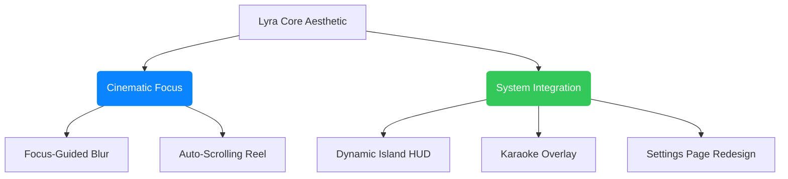

# Lyra: Comprehensive Product & UX Design Review Report

This report presents a thorough, professional UX and product design audit of the Lyra lyrics synchronization and playback overlay system. The evaluation focus is on layout hierarchies, visual systems, motion choreography, cognitive load, platform conventions, accessibility (a11y), and interaction mapping across all four main surfaces.

---

## 1. Executive Summary & Design Philosophy

Lyra positions itself as a premium, highly synchronized desktop lyrics overlay. It utilizes modern visual treatments like glassmorphism, dynamic gradients, and fluid motion to create a premium atmosphere. 

However, a deep audit of the interaction models reveals several **critical usability gaps** where standard media player conventions are broken, and visual polish occasionally compromises functional utility.



---

## 2. Balancing Aesthetics: Must the Blur Be Removed?

**No. The blur should absolutely not be removed completely.** The blur is a signature visual treatment of Lyra, establishing visual depth and giving the application its cinematic, ambient identity. Completely removing it would make the app look flat and generic.

The issue isn't the presence of blur, but rather its **uniform application**, which creates legibility and scanning problems:
* **The Current Issue**: Outgoing lines are blurred by `3px` and upcoming lines by `4px` at `0.85` opacity. This makes scanning even one line ahead/behind painful, as the eye is forced to fight high-strength Gaussian filters.

### The Solution: Focus-Guided Blur (Depth-of-Field)
Instead of a binary toggle, implement a gradient of blur and opacity based on proximity to the active lyric line. This preserves the premium depth-of-field aesthetic while restoring immediate legibility:

```
[Distal Line (Passed)]  ---  blur(3px)   |  opacity: 0.25
[Proximal Line (Passed)] --  blur(1px)   |  opacity: 0.55
[ ACTIVE LYRIC LINE ]   ---  blur(0px)   |  opacity: 1.0  | scale(1.04)
[Proximal Line (Future)] --  blur(1px)   |  opacity: 0.60
[Distal Line (Future)]  ---  blur(3px)   |  opacity: 0.30
```

By reducing the blur to a subtle `1px` for the lines directly above and below the active line, the user's peripheral vision can easily scan ahead. Distant lines are allowed to blur more aggressively (`3px` or `4px`) as they recede into the background.

---

## 3. Settings Page: UI & Layout Critique

The Settings page currently suffers from a structural identity crisis. It attempts to adapt to the host operating system's native preferences panel (macOS vs. Windows), but in doing so, it introduces layout bugs and compromises clarity.

### Why the Current Settings Page Layout is Confusing & Looks Poor:

#### 1. Hiding Structural Headers on macOS
In `settings.css`, the group titles (`.group-title`) are hidden when the platform is detected as macOS.
* **Impact**: On macOS, settings like "Theme", "Polling Interval", "Hide when paused", "Launch at login", and "Lyrics Cache" are listed one after another in a flat list with no visual headers separating them. This destroys the visual hierarchy. The user cannot tell where "System" settings end and "Startup" or "Storage" settings begin.

#### 2. The Right-Aligned Label "Zig-Zag" (macOS)
On macOS, row labels are right-aligned with a fixed width of `160px`.
* **Impact**: This forces a wide gap between the left edge of the page and the start of shorter labels. The user's eye has to start scanning from different horizontal starting points depending on label length. Worse, the controls (like checkbox toggles or select boxes) are left-aligned on the right-hand column, causing the label and its control to drift apart.

```
       [ macOS Layout Gap ]
       General Settings
       ----------------
        Theme:  [Auto     ]
       Launch:  [x]
  Clear Cache:  [Clear    ]
  ^^^ Empty Space
```

#### 3. Control Sizing Inconsistencies
Interactive controls like `select` and `input[type="checkbox"]` have narrow, default widths, while `SnapSlider` has a hardcoded width of `250px`. This makes rows look uneven: some rows have controls that stretch halfway across the screen, while others have tiny checkboxes floating in empty space.

#### 4. Cognitive Fragmentation
Settings are grouped by *surface* ("Lyra", "Dynamic Island", "Karaoke") rather than by *intent*. A user configuring the app has to visit three different pages to adjust simple behaviors like font size or fullscreen rules, leading to redundant clicks.

---

## 4. Settings UI: Component Audit

This section analyzes the specific UI controls used in `views/settings/index.tsx` and their visual/behavioral shortcomings.

### A. The Morphing Checkbox-Switch (`Toggle` Component)
* **The Implementation**: The `Toggle` component is rendered using a standard checkbox input. On Windows, it is styled as a Fluent switch, but on macOS, it is customized to look like a flat, native checkbox.
* **Critique**:
  * **Interactive Model Conflict**: Checkboxes and toggle switches carry different mental models. Toggle switches represent **immediate action** (like turning a feature on/off), while checkboxes represent **item selection inside a form** before submission. Forcing the toggle component to morph between these controls depending on the OS is confusing.
  * **Visual Polish**: Checkboxes are static and feel outdated in modern, fluid layouts. A high-quality toggle switch (used consistently across platforms) with a smooth sliding track animation feels significantly more premium.

### B. Segmented Controls (`Segmented` Component)
* **The Implementation**: A horizontal bar containing multiple borderless buttons where the active option gets a white background card with a drop shadow.
* **Critique**:
  * **Lack of Motion Transitions**: When switching options (e.g., from Center to Right alignment), the active block jumps instantly. In high-end design systems, the white card background **slides smoothly** between options, giving a tactile, physics-based feel to the interface.
  * **Cursor Paradox**: The segmented buttons use `cursor: default`. While matching native macOS settings conventions, this feels broken on hybrid web-based shells (Tauri), where users expect a pointer cursor on interactive elements.

### C. Native Dropdowns (`select` Elements)
* **The Implementation**: A native `<select>` drop-down styled with a custom SVG arrow background.
* **Critique**:
  * **Jarring Visual Discordance**: When clicked, the dropdown triggers the host operating system's native menu window. This menu completely ignores the app's dark mode, glassmorphic styling, and color theme, rendering as a stark white/gray system menu block.
  * **Click Efficiency**: Selecting a value from a dropdown takes two clicks (open dropdown -> select option). For small, static lists (like Theme: Light/Dark/Auto), a **Segmented Control** or a **Radio Group** is much better as it exposes all choices immediately, reducing interaction costs to a single click.

### D. The Misaligned Snap-Slider (`SnapSlider` Component)
* **The Implementation**: Uses a native `<input type="range">` where ticks are represented by text labels in a separate, bottom flex container (`.snap-slider-labels`).
* **Critique**:
  * **Visual Drift (Alignment Shift)**: Because the bottom labels are spaced out using `justify-content: space-between`, they align to their outer boundaries, not the actual slider thumb snaps. Longer labels (e.g., "Normal (100%)") drift left or right, failing to sit directly beneath the corresponding snap points of the slider track.
  * **Blind Snapping**: There are no physical tick marks on the slider track. The user is left guessing the exact snap boundaries.

```
  Slider Track:  O===========|===========O
  Snap Labels:  [Min]      [Normal]    [Max]
                  ^           ^          ^
                 (Visual alignment mismatch)
```

---

## 5. Settings Page: Proposed Redesign Layout

To clean up the Settings page, we should adopt a modern, unified layout structure that works beautifully across all platforms without breaking native expectations.

```
+-----------------------------------------------------------------------+
|  Settings                             General                         |
|  +------------------+                 ========================        |
|  | (o) General      |                 SYSTEM                          |
|  |                  |                 +-----------------------------+ |
|  | SURFACES         |                 | Theme                 [Dark]| |
|  | [ ] Main Window  |                 | Polling Interval      [Fast]| |
|  | [ ] Dynamic Island|                | Hide when paused        (o) | |
|  +------------------+                                                 |
|                                       STORAGE                         |
|                                       +-----------------------------+ |
|                                       | Lyrics Cache (12.4 MB)[Clear] |
|                                       +-----------------------------+ |
+-----------------------------------------------------------------------+
```

### Key Layout & Component Updates:
1. **Restore Group Headers Globally**: Keep `.group-title` visible on all platforms. Use subtle uppercase styles or muted text colors to establish divisions.
2. **Left-Align Row Labels**: Align all labels to the left edge of the content container. This creates a clean vertical reading line.
3. **Right-Align Controls**: Move all interactive elements (switches, dropdowns, buttons) to the right edge of the card. This separates description from action and matches modern design systems.
4. **Custom Dropdowns**: Replace native `<select>` dropdowns with styled custom popover overlays (similar to shadcn/radix dropdown menus) to preserve the app's glassmorphism and color theme.
5. **Tick-Aligned Slider**: Redesign the slider to render tick markers on the track itself, and center each label text directly below its snap coordinates.

---

## 6. High-Priority Usability Gaps

### A. The "Hair-Trigger" Lyric-Seek Trap
* **The Issue**: In the main lyrics view, clicking *any single lyric line* instantly seeks the music playback to the start timestamp of that line (`playback_seek_ms`). Because the entire right side of the screen is an active click-target for seeking, users attempting to select text, scroll the view, or simply click to focus the Lyra window will accidentally trigger a playback seek.
* **UX Recommendation**: Require a double-click to seek, or display a visible play-arrow icon next to a line only when hovered to indicate that clicking will change playback.

### B. Broken Progress Bar Conventions (Click-Only seeking)
* **The Issue**: The sidebar progress bar accepts a single click-to-jump action, but does **not support scrubbing (dragging to seek)**. In modern audio players, dragging the progress handle is the standard way users scrub through audio.
* **UX Recommendation**: Implement standard mouse-down drag listeners to allow dragging along the X-axis of `.progress-track`, updating the track position in real-time.

### C. Missing Core Audio Control: Volume
* **The Issue**: Lyra acts as a playback controller with skip, back, and play/pause buttons, but completely omits a **Volume Slider**. Users must navigate away to the system menu bar or Spotify itself to adjust the volume.
* **UX Recommendation**: Add a compact volume slider next to the transport controls in the sidebar.

### D. The Hidden "Import LRC" Capability
* **The Issue**: The Rust backend supports an `ImportOverride` intent to load local `.lrc` override files when lyrics are missing. However, the user interface contains **absolutely no button, drag-and-drop zone, or file-picker** to upload an LRC override. 
* **UX Recommendation**: Add a "Link LRC File" button directly on the "No synced lyrics" placeholder view and in the settings page.

---

## 7. Summary of Suggested UX/UI Polish

The following task list outlines recommended design adjustments to polish the Lyra UX:

- [ ] **Main App**: Refine the lyric line blur into a Focus-Guided Depth-of-Field effect rather than a flat, heavy blur on all un-active lines.
- [ ] **Main App**: Replace click-to-seek lyric logic with double-click seek or hover-seek buttons to prevent "hair-trigger" seeks.
- [ ] **Main App**: Implement click-and-drag scrubbing on the progress bar instead of click-only jump.
- [ ] **Main App**: Add a volume control slider to the sidebar controls.
- [ ] **Main App**: Enable a "Manual Search" or "Import LRC" file button when lyrics are not found.
- [ ] **Main App**: Isolate the top window-drag region to avoid accidental drag triggers near interactive elements.
- [ ] **Settings**: Restore section headers on macOS by displaying `.group-title` and removing the transparent container overrides.
- [ ] **Settings**: Left-align row labels and right-align interactive controls on macOS to eliminate the awkward alignment gap.
- [ ] **Settings**: Replace native `<select>` dropdowns with styled custom popover menus to match the dark/ambient theme.
- [ ] **Settings**: Redesign `SnapSlider` to align text labels directly beneath physical snap tick marks.
- [ ] **Settings**: Unify toggle switches across macOS and Windows to maintain a single, modern interactive control paradigm.
- [ ] **Settings**: Rename the "Lyra" settings tab to "Main Window" to prevent confusion with the overall app name.
- [ ] **Settings**: Retrieve and display active folder sizes next to the "Clear cache" button.
- [ ] **Settings**: Show a subtle confirmation indicator (toast or status text) when settings are successfully saved.
- [ ] **Dynamic Island**: Change the scrolling text from a percentage-based glide to a constant-speed marquee.
- [ ] **Dynamic Island**: Remove the canned CSS bouncing bars and replace them with a track progress ring or a simple static audio state icon.
- [ ] **Karaoke**: Add a translucent, text-bounded backdrop option to preserve readability over light wallpapers/apps.
- [ ] **Karaoke**: Dynamically balance layout height when showing a single line of lyrics.
